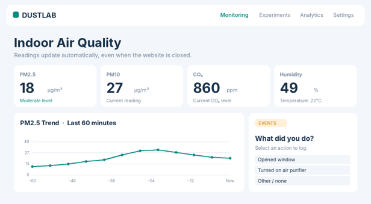

# DustLab — Project Overview

## 1. Background and Motivation

People with allergies or sensitivities to household dust may experience symptoms such as sneezing, a runny nose, nasal congestion, and watery or irritated eyes. Managing the indoor environment can be an important part of everyday life, but airborne particles are often invisible. This makes it difficult to understand how routine activities affect the air in a particular room.

Cleaning, cooking, and ventilation can change airborne particle concentrations. Opening a window or using an air purifier may reduce those concentrations, but the outcome depends on the conditions indoors and outdoors. Without recorded measurements, it is hard to tell what happened or compare different approaches fairly.

**DustLab focuses on measuring airborne particles and helping users evaluate practical ways to reduce their concentration at home.** It does not directly measure allergens or determine whether a room is safe for an individual with allergies.

## 2. Problem Statement

A person may notice dust or experience discomfort without knowing:

- When airborne particle concentrations increase and for how long.
- Whether cleaning or cooking is associated with a noticeable change.
- What happens after opening a window or turning on an air purifier.
- Which method has reduced particle concentrations more quickly under comparable conditions.

A basic air-quality monitor shows current readings but does not necessarily connect them to household activities or preserve enough context for meaningful comparisons.

**The problem DustLab addresses is the lack of an accessible way to connect indoor particle measurements with user-recorded activities and evaluate changes over time.**

*Figure 1. Overview of the DustLab IoT system.*

## 3. Target Users

**Primary users:** people with household dust allergies or sensitivities who want to understand particle levels in their indoor environment.

**Secondary users:** households and students interested in indoor air quality, environmental monitoring, and data-based experiments.

The system is intended to support awareness and informed decisions, not to provide individual medical advice.

## 4. Project Aim

To design and develop an IoT prototype using **Raspberry Pi 5**, environmental sensors, a web application, and an **SQLite database** that continuously monitors indoor air conditions and allows users to investigate how everyday activities and interventions are associated with changes in airborne particle concentrations.

## 5. Proposed Solution

*Figure 2. High-level overview of the DustLab system.*

The original DustLab concept proposed two complementary modes. Following the scope revision, only Monitoring Mode will be implemented for this submission. Both are described below to document the original concept.

### Monitoring Mode — selected for implementation

Sensors record **PM1, PM2.5, PM10, CO₂, temperature, and relative humidity** at regular intervals. The system stores readings even when the web dashboard is closed. Users can view current values, historical graphs, and configurable alerts for sustained increases in particle concentrations.

After an alert, the user can record an action such as **“Opened window”** or **“Turned on air purifier.”** DustLab links the event timestamp with measurements before and after the action so the user can see what changed.

### Experiment Mode — original concept, deferred

This mode is retained as part of the original proposal but is outside the scope of this submission. The features below describe a potential future enhancement.

A user selects an activity, such as cleaning or cooking, then marks its start and finish in the application. DustLab records the experiment in three stages:

1. **Baseline:** measure typical conditions for approximately 10–15 minutes before the activity.
2. **Activity:** mark the start and end times and monitor changes in particle concentrations.
3. **Recovery:** continue recording after the activity and calculate how readings change over time.

Users can repeat experiments and compare results, including scenarios with **an open window**, **an air purifier**, or **no intervention**. The application will not infer that an activity caused a change solely because the events occurred close together.

## 6. Project Objectives

The following objectives apply to the revised scope, which focuses on Monitoring Mode:

1. Collect reliable time-stamped readings from the PMS7003 and SCD41 sensors connected to a Raspberry Pi 5.
2. Transmit sensor readings to a cloud-hosted FastAPI application using a publish-subscribe service.
3. Store measurements, manually recorded user actions, and alert records in SQLite.
4. Build a web dashboard displaying current readings, historical graphs, and alerts for sustained increases in PM2.5 concentrations.
5. Allow users to record actions manually and display these events alongside the measurements.
6. Deploy the application to AWS using a custom HTTPS domain, require user authentication, and secure data in transit and at rest.
7. Test the complete monitoring workflow and document the prototype’s limitations.

## 7. User Scenarios

The table below distinguishes scenarios included in the current scope from those retained as potential future enhancements.
Each row describes a separate scenario, not a sequence of actions. The user records one action at a time, such as opening a window or turning on an air purifier, and observes the subsequent measurements before taking another action.

| Scenario | User interaction | Expected system response | Scope status |
|---|---|---|---|
| User checks air quality | Opens the dashboard | Shows current readings and historical graphs | Current scope |
| PM2.5 remains elevated | Views the dashboard warning | Shows the alert and recent PM2.5 trend | Current scope |
| User opens a window | Selects **Opened window** | Saves the event timestamp and displays a marker alongside measurements | Current scope |
| User turns on an air purifier | Records the action in the dashboard | Saves the event timestamp so the user can observe subsequent readings | Current scope |
| User starts a structured cleaning experiment | Selects **Cleaning → Start**, then **Finish** | Tracks baseline, activity, and recovery stages | Future enhancement |
| User compares experiments | Opens the experiment comparison page | Shows selected experiment results and their conditions | Future enhancement |

For the initial version, user activities are **recorded manually**. Automatic window detection and air-purifier status tracking may be added later using a magnetic contact sensor or a compatible smart plug.

## 8. Scope Revision

The initial DustLab concept included Monitoring Mode and Experiment Mode. Following lecturer feedback that the proposed scope was too large, the project will focus on Monitoring Mode for this submission. Experiment Mode is deferred as a potential future enhancement. This allows more time for implementation, testing, cloud deployment, and security.

## 9. Scope 

### Minimum Viable Product (MVP)

- Raspberry Pi 5, SCD41, and PMS7003 sensor integration.
- Continuous sensor data collection and transmission using MQTT.
- Storage of measurements, user actions, and alert records in SQLite.
- A FastAPI web dashboard with current readings and historical charts.
- Configurable alerts for sustained increases in PM2.5.
- Manual logging of one user action at a time, with timestamped markers on the measurement graphs.
- AWS deployment with a custom HTTPS domain.
- User authentication and protection of data in transit and at rest.

### Outside the Current Scope

The following features belong to the original Experiment Mode concept
and will not be implemented for this submission:

- Structured experiment setup and start/finish controls.
- Automatic tracking of baseline, activity, and recovery stages.
- Automated experiment summaries and recovery-time calculations.
- Automated comparisons between experiments or interventions.

Users can observe measurements before and after a recorded action
on the historical graph, but the MVP will not automatically evaluate
or rank interventions.

### Potential Future Enhancements

- Automatic window open/close detection.
- Experiment Mode with structured workflows and automated comparisons.
- Automatic air-purifier status tracking.
- Exportable reports and more advanced comparisons.
- Predictions based on accumulated measurements, once sufficient data is available.

Hardware wiring, detailed database structure, application architecture, and experiment procedures will be documented separately.

## 9. Evaluation and Success Criteria

The prototype will be considered successful if:

- Readings from both sensors are collected with correct timestamps and transmitted to the cloud application using MQTT.
- Measurements are stored in SQLite while the web dashboard is closed.
- The dashboard displays current readings and historical graphs from the stored measurements.
- A PM2.5 alert is triggered when readings remain above the configured threshold for the configured duration.
- The user can record one action at a time, and each action appears with the correct timestamp alongside the measurements.
- The application is accessible through a custom HTTPS domain hosted on AWS.
- Unauthenticated users cannot access protected dashboard pages or data endpoints.
- Security measures for data in transit and at rest are implemented, tested, and documented.

Testing will cover the complete workflow from sensor readings to
dashboard display, including data storage, alerts, and manual action
logging. Any simulated readings used during testing will be clearly
identified.

Observations before and after individual actions may be used to
demonstrate the monitoring functionality. Structured experiment
reports, automated recovery-time calculations, and comparisons
between interventions are not success criteria for this submission.

## 10. Limitations and Responsible Use

- **Particle sensors are not allergen detectors.** PMS7003 measures airborne particles; it cannot identify dust-mite allergens, pollen, mould spores, or other specific triggers.
- **Results are environmental observations, not medical conclusions.** DustLab cannot diagnose, treat, or predict allergic symptoms.
- **Changes are not proof of causation.** Outdoor air, humidity, ventilation, sensor position, and new particle sources can influence results.
- **Ventilation does not always lower indoor PM.** Opening a window may introduce particles from outdoors.
- **Tests should use normal household activities.** Users should not deliberately create smoke or dust to demonstrate the system.

## 11. Expected Outcome

The final outcome will be a working IoT prototype and cloud-hosted
web application focused on Monitoring Mode.

DustLab will provide continuous indoor air-quality measurements,
current readings, historical graphs, alerts for sustained increases
in PM2.5, and manual action logging. Users will record one action
at a time and observe subsequent measurements on the dashboard.

The system will demonstrate sensor integration, MQTT communication,
database storage, secure access, and deployment to AWS using a
custom HTTPS domain.

The project's value is in helping users observe indoor air-quality
trends and changes following individual actions. These observations
will not establish that an action caused a particular change.

Experiment Mode remains part of the original concept and may be
developed as a future enhancement.
