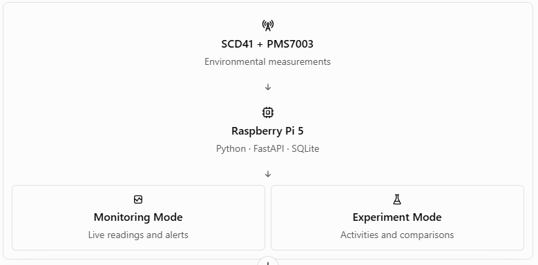

# DustLab — Project Overview

## 1. Background and Motivation

People with allergies or sensitivities to household dust may experience symptoms such as sneezing, a runny nose, nasal congestion, and watery or irritated eyes. Managing the indoor environment can be an important part of everyday life, but airborne particles are often invisible. This makes it difficult to understand how routine activities affect the air in a particular room.

Cleaning, cooking, and ventilation can change airborne particle concentrations. Opening a window or using an air purifier may reduce those concentrations, but the outcome depends on the conditions indoors and outdoors. Without recorded measurements, it is hard to tell what happened or compare different approaches fairly.

**DustLab focuses on measuring airborne particles and helping users evaluate practical ways to reduce their concentration at home.** It does not directly measure allergens or determine whether a room is safe for an individual with allergies.

## 2. Problem Statement

A person may notice dust or experience discomfort without knowing:

- When airborne particle concentrations increase and for how long.
- Whether cleaning or cooking is associated with a noticeable change.
- What happens after opening a window or turning on an air purifier.
- Which method has reduced particle concentrations more quickly under comparable conditions.

A basic air-quality monitor shows current readings but does not necessarily connect them to household activities or preserve enough context for meaningful comparisons.

**The problem DustLab addresses is the lack of an accessible way to connect indoor particle measurements with user-recorded activities and evaluate changes over time.**

*Figure 1. Overview of the DustLab IoT system.*

## 3. Target Users

**Primary users:** people with household dust allergies or sensitivities who want to understand particle levels in their indoor environment.

**Secondary users:** households and students interested in indoor air quality, environmental monitoring, and data-based experiments.

The system is intended to support awareness and informed decisions, not to provide individual medical advice.

## 4. Project Aim

To design and develop an IoT prototype using **Raspberry Pi 5**, environmental sensors, a web application, and an **SQLite database** that continuously monitors indoor air conditions and allows users to investigate how everyday activities and interventions are associated with changes in airborne particle concentrations.

## 5. Proposed Solution

*Figure 2. High-level overview of the DustLab system.*

DustLab combines two complementary modes:

### Monitoring Mode — everyday awareness

Sensors record **PM1, PM2.5, PM10, CO₂, temperature, and relative humidity** at regular intervals. The system stores readings even when the web dashboard is closed. Users can view current values, historical graphs, and configurable alerts for sustained increases in particle concentrations.

After an alert, the user can record an action such as **“Opened window”** or **“Turned on air purifier.”** DustLab links the event timestamp with measurements before and after the action so the user can see what changed.

### Experiment Mode — structured comparisons

A user selects an activity, such as cleaning or cooking, then marks its start and finish in the application. DustLab records the experiment in three stages:

1. **Baseline:** measure typical conditions for approximately 10–15 minutes before the activity.
2. **Activity:** mark the start and end times and monitor changes in particle concentrations.
3. **Recovery:** continue recording after the activity and calculate how readings change over time.

Users can repeat experiments and compare results, including scenarios with **an open window**, **an air purifier**, or **no intervention**. The application will not infer that an activity caused a change solely because the events occurred close together.

## 6. Project Objectives

1. Collect reliable time-stamped readings from a **PMS7003** particle sensor and an **SCD41** environmental sensor.
2. Build a web interface for live readings, charts, historical data, and alerts.
3. Implement Monitoring Mode and Experiment Mode with manual recording of user actions.
4. Store measurements, experiments, event timestamps, and settings in SQLite.
5. Calculate baseline values, peak values, changes from baseline, and recovery times where a target is reached.
6. Compare repeated experiments under reasonably similar conditions and present the results clearly.
7. Test the prototype and document its accuracy limitations and practical usefulness.

## 7. User Scenarios

| Scenario | User interaction | Expected system response |
|---|---|---|
| PM2.5 rises during the day | Opens the dashboard after an alert | Shows the current value, recent trend, and alert history |
| User opens a window | Selects **Opened window** | Saves the event time and displays subsequent measurements |
| User starts cleaning | Selects **Cleaning → Start**, then **Finish** | Marks the activity and analyses the baseline, peak, and recovery |
| User tests an air purifier | Records when it is switched on | Tracks the particle trend following activation |
| User wants to compare methods | Opens the comparison page | Shows results from selected experiments and their conditions |

For the initial version, user activities are **recorded manually**. Automatic window detection and air-purifier status tracking may be added later using a magnetic contact sensor or a compatible smart plug.

## 8. Scope

### Minimum Viable Product (MVP)

- Raspberry Pi 5, SCD41, and PMS7003 sensor integration.
- Continuous measurements stored in SQLite.
- Web dashboard with current readings and historical charts.
- Configurable alerts for sustained particle increases.
- Manual activity logging and experiment start/finish controls.
- Experiment summaries and basic comparisons.

### Potential Future Enhancements

- Automatic window open/close detection.
- Automatic air-purifier status tracking.
- Exportable reports and more advanced comparisons.
- Predictions based on accumulated measurements, once sufficient data is available.

Hardware wiring, detailed database structure, application architecture, and experiment procedures will be documented separately.

## 9. Evaluation and Success Criteria

The prototype will be considered successful if:

- Sensor readings are collected and stored with correct timestamps during a test period, including while the browser is closed.
- Both operating modes function without manually entering sensor readings.
- User actions appear as correctly timed markers alongside the recorded data.
- The application generates at least two comparable experiment reports with baseline, peak, and recovery information.
- Repeated tests can be compared through tables or graphs; results can be explained together with their limitations.

For meaningful comparisons, experiments should use a consistent sensor position and room setup, record relevant conditions, and ideally repeat each scenario **at least three times**. A shorter recovery time can be reported only when the selected target is actually reached.

## 10. Limitations and Responsible Use

- **Particle sensors are not allergen detectors.** PMS7003 measures airborne particles; it cannot identify dust-mite allergens, pollen, mould spores, or other specific triggers.
- **Results are environmental observations, not medical conclusions.** DustLab cannot diagnose, treat, or predict allergic symptoms.
- **Changes are not proof of causation.** Outdoor air, humidity, ventilation, sensor position, and new particle sources can influence results.
- **Ventilation does not always lower indoor PM.** Opening a window may introduce particles from outdoors.
- **Tests should use normal household activities.** Users should not deliberately create smoke or dust to demonstrate the system.

## 11. Expected Outcome

The final outcome will be a working educational IoT prototype and web application that provide continuous indoor air-quality monitoring, time-stamped activity records, structured experiments, and clear comparisons of particle reduction methods.

The project's value is not simply displaying sensor numbers: **it helps users understand what happened to the air in a specific room before, during, and after everyday actions.**
