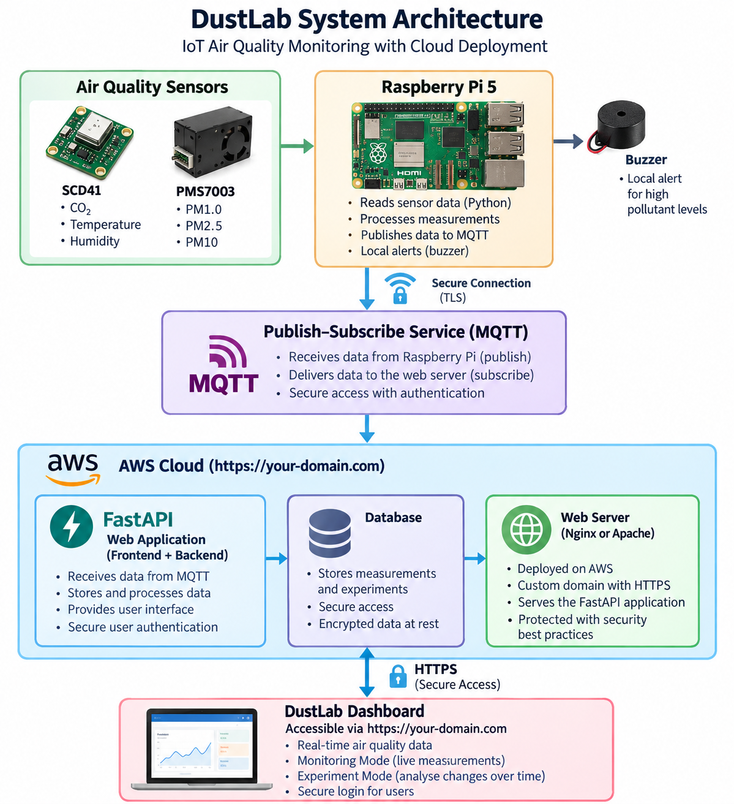

## System Architecture Overview

The diagram below illustrates the proposed architecture of DustLab, including sensor data collection, MQTT communication, cloud deployment, data storage, and secure access to the web dashboard.

*Figure 1. Proposed system architecture of DustLab.*

## Current Implementation Scope

The architecture described here supports the Monitoring Mode MVP.
Experiment management, automated recovery-time calculations, and
comparisons between interventions are outside the current scope.

## Planned System Components

- **Raspberry Pi 5:** reads measurements from the PMS7003 and SCD41 sensors.
- **MQTT broker:** provides publish-subscribe communication between the Raspberry Pi and the cloud application.
- **FastAPI application:** processes incoming measurements and provides authenticated access to the web dashboard.
- **SQLite database:** stores measurements, manually recorded actions, and alert records.
- **Web dashboard:** displays current readings, historical graphs, PM2.5 warnings, and timestamped action markers.

The web application will be deployed to AWS and accessed through
a custom HTTPS domain.

## Planned Data Flow

1. The Raspberry Pi collects sensor readings and attaches a timestamp and device identifier.
2. The Raspberry Pi publishes the readings to an MQTT topic.
3. A subscriber running on the cloud server receives and validates the messages.
4. Valid measurements are stored in SQLite.
5. The FastAPI application retrieves the stored data for the dashboard.
6. An authenticated user can record one action at a time. The application stores the action and its timestamp.
7. The dashboard displays action markers alongside measurements so the user can observe subsequent changes.

Sensor data collection and storage will continue while the dashboard
is closed. Physical actions, such as opening a window or switching
on an air purifier, will be performed manually by the user.

## Planned Security Measures

- **User access:** users will sign in before accessing the dashboard
  or protected data endpoints. Passwords will be stored as secure
  hashes rather than plain text.
- **Web traffic:** the application will use HTTPS through a custom domain.
- **MQTT communication:** connections will use TLS and authentication.
  Topic permissions will restrict each client to the required
  publish and subscribe operations.
- **Database access:** the SQLite file will be accessible only to
  authorised server processes and administrators. It will not be
  publicly served or committed to Git.
- **Data at rest:** the AWS storage volume containing the database
  and any backups will use encryption at rest.
- **Device and server access:** administrative access will be restricted,
  default credentials will be replaced, and software will be kept updated.
- **Secrets:** passwords and other credentials will be stored outside
  the source code and excluded from version control.

